# PokeDex - Laboratorio 12

Aplicación Android en Kotlin que consume la **PokeAPI**, guarda los datos en el celular con **Room**, permite marcar **favoritos**, funciona **sin conexión** e ingresa con **Firebase Authentication** usando dos roles (**admin** y **usuario**) leídos desde **Firestore**. Al sincronizar muestra una **notificación local**.

| Dato | Valor |
|---|---|
| Curso | Programación en Móviles - 4to ciclo |
| Carrera | Diseño y Desarrollo de Software - TECSUP |
| Docente | Juan José León Suiyon |
| Laboratorio | 12: Compose + MVVM + Retrofit + Room + Firebase Auth + Firestore |
| Tema | Pokémon (PokeAPI) |
| Variante | Todos los tipos con sus Pokémon, detalle por Pokémon |
| Paquete | `com.tecsup.pokemon` |
| Integrante | Daniel Millones V. |

---

## Índice

1. [Funcionalidades](#1-funcionalidades)
2. [API consumida](#2-api-consumida)
3. [Arquitectura MVVM](#3-arquitectura-mvvm)
4. [Estructura del proyecto](#4-estructura-del-proyecto)
5. [Tecnologías](#5-tecnologías)
6. [Cómo compilar](#6-cómo-compilar)
7. [Configuración de Firebase](#7-configuración-de-firebase)
8. [Capturas](#8-capturas)
9. [Requisitos cumplidos](#9-requisitos-cumplidos)
10. [Pruebas de aceptación](#10-pruebas-de-aceptación)
11. [Git y commits](#11-git-y-commits)
12. [Reparto de tareas](#12-reparto-de-tareas)

---

## 1. Funcionalidades

| Funcionalidad | Usuario | Admin |
|---|:---:|:---:|
| Ingresar con correo y contraseña | Sí | Sí |
| Ver tipos de Pokémon (nombre en español e ícono) | Sí | Sí |
| Ver los Pokémon de un tipo | Sí | Sí |
| Ver el detalle de un Pokémon | Sí | Sí |
| Marcar favoritos y ver la pantalla Favoritos | Sí | Sí |
| Sincronizar manualmente | Sí | Sí |
| Usar la app sin conexión con los datos guardados | Sí | Sí |
| Cerrar sesión | Sí | Sí |
| Panel Admin: totales, Sincronizar y Limpiar caché | No | Sí |

El rol **no se decide en la app**: se guarda en Firestore (`usuarios/{uid}` con el campo `rol`) y la app lo lee después de ingresar.

---

## 2. API consumida

**Base URL:** `https://pokeapi.co/api/v2/` (pública, solo lectura, sin clave)

| Uso | Endpoint | Cuándo se llama |
|---|---|---|
| Lista de tipos | `type/?limit=100` | Al sincronizar |
| **Lista** (primer endpoint) | `type/{nombre}` | Al sincronizar, una vez por tipo y en paralelo |
| **Detalle** (segundo endpoint) | `pokemon/{id}` | Al tocar un Pokémon |
| Imagen del Pokémon | `raw.githubusercontent.com/PokeAPI/sprites/.../official-artwork/{id}.png` | Se arma con el id, no consume la API |
| Ícono del tipo | `raw.githubusercontent.com/PokeAPI/sprites/.../types/generation-ix/scarlet-violet/small/{id}.png` | Se arma con el id del tipo |

**Filtros aplicados en el Repository:**
- Se descartan los tipos sin Pokémon (`unknown`, `shadow`, `stellar`).
- Se descartan las formas especiales con id mayor o igual a 10000 (megas, gigamax, formas regionales).
- Se eliminan duplicados, porque un Pokémon puede tener dos tipos.

---

## 3. Arquitectura MVVM

```
Pantalla (Compose)
   │  observa con collectAsStateWithLifecycle() y llama funciones
   ▼
ViewModel  ── StateFlow<UiState<T>> (Cargando, Exito, Error)
   │  depende de interfaces
   ▼
ItemRepository / AuthRepository / Notificador   (interfaces)
   │  implementadas por
   ▼
ItemRepositoryImpl        FirebaseAuthRepository        NotificadorAndroid
   │          │                  │          │
ApiService   ItemDao        Firebase Auth  Firestore
(Retrofit)   (Room)
```

**Reglas MVVM cumplidas:**
- Las pantallas solo observan el estado y llaman funciones del ViewModel.
- No se usa Retrofit, Room ni Firebase dentro de un composable.
- El ViewModel no recibe `Context`. La notificación se pide mediante la interface `Notificador`.
- Los repositorios son interfaces y el ViewModel depende de la interface, nunca de la clase concreta.
- Tres modelos distintos: **DTO** (API), **Entity** (Room) y **modelo de dominio** (UI). Los mappers los convierten.
- **Room es la fuente única de verdad**: la lista que ve el usuario sale siempre de Room y Retrofit solo la actualiza.
- Cada ViewModel expone un `StateFlow` que solo él modifica.
- Los ViewModel se crean con un `ViewModelProvider.Factory` (`AppViewModelProvider`) que recibe el `AppContainer`.

**Flujo de los datos:**
```
Guardar:  PokeAPI (JSON) → Gson → DTO → mapper aEntity() → Entity → Dao → Room
Mostrar:  Room → Dao → Entity → mapper aModelo() → Modelo → ViewModel → Pantalla
```

**Base de datos Room (3 tablas):**

| Tabla | Campos | Uso |
|---|---|---|
| `items` | `id` (PK), `nombre`, `imagenUrl`, `esFavorito` | Pokémon guardados |
| `tipos` | `nombre` (PK), `nombreEs`, `iconoUrl` | Tipos con nombre en español |
| `item_tipo` | `itemId` + `tipo` (PK compuesta) | Relación muchos a muchos Pokémon - tipo |

Los favoritos se conservan al sincronizar: antes de guardar se leen con `idsFavoritos()` y se vuelven a aplicar.

---

## 4. Estructura del proyecto

```
app/src/main/java/com/tecsup/pokemon/
├── MainActivity.kt              ← pide el permiso de notificaciones y muestra AppNav
├── PokeDexApp.kt                ← Application que guarda el AppContainer
├── AppContainer.kt              ← crea API, base de datos, repositorios y notificador
├── data/
│   ├── remote/
│   │   ├── ApiService.kt        ← interface Retrofit (@GET)
│   │   ├── RetrofitClient.kt
│   │   └── dto/                 ← TipoDto.kt, PokemonDto.kt
│   ├── local/
│   │   ├── ItemEntity.kt, TipoEntity.kt, ItemTipoEntity.kt
│   │   ├── ItemDao.kt
│   │   └── AppDatabase.kt
│   ├── auth/
│   │   ├── AuthRepository.kt    ← interface
│   │   └── FirebaseAuthRepository.kt
│   ├── repository/
│   │   ├── ItemRepository.kt    ← interface
│   │   └── ItemRepositoryImpl.kt
│   └── mapper/Mappers.kt        ← DTO → Entity → modelo
├── domain/model/
│   ├── Item.kt                  ← Item e ItemDetalle
│   ├── Tipo.kt
│   └── Sesion.kt                ← Sesion + enum Rol
├── notification/
│   ├── Notificador.kt           ← interface
│   └── NotificadorAndroid.kt
└── ui/
    ├── UiState.kt
    ├── AppViewModelProvider.kt  ← Factory de los ViewModel
    ├── navigation/              ← AppNav.kt, SesionViewModel.kt
    ├── components/              ← Cargando, ErrorView, VacioView, ItemsGrid
    ├── login/                   ← LoginScreen, LoginViewModel
    ├── tipos/                   ← TiposScreen, TiposViewModel
    ├── lista/                   ← ListaScreen, ListaViewModel
    ├── detalle/                 ← DetalleScreen, DetalleViewModel
    ├── favoritos/               ← FavoritosScreen, FavoritosViewModel
    ├── admin/                   ← AdminScreen, AdminViewModel
    └── theme/
```

---

## 5. Tecnologías

| Tecnología | Uso |
|---|---|
| Kotlin + Jetpack Compose + Material 3 | Interfaz, sin XML |
| Navigation Compose | Navegación entre pantallas y argumentos de ruta |
| Lifecycle ViewModel + StateFlow | Estado de cada pantalla |
| Retrofit + Gson + OkHttp | Consumo de la PokeAPI |
| Room + KSP | Base de datos local |
| Coil | Carga de imágenes por URL con caché |
| Firebase Authentication | Ingreso con correo y contraseña |
| Cloud Firestore | Rol de cada usuario |
| Coroutines | Tareas en segundo plano y peticiones en paralelo |
| NotificationCompat | Notificación local |

**SDK:** `minSdk 26`, `targetSdk 36`, `compileSdk 37`.

---

## 6. Cómo compilar

**Requisitos:** Android Studio actualizado, JDK 17 o superior y un emulador o celular con Android 8 o superior y Google Play Services.

1. Clonar el repositorio:
   ```bash
   git clone <url-del-repositorio>
   ```
2. Abrir en Android Studio la carpeta `Semana 12/PokeDex`.
3. Colocar el archivo `google-services.json` dentro de `app/` (ver sección 7). **No está en el repositorio** porque contiene la clave de API.
4. **Sync Project with Gradle Files**.
5. **Run** sobre el emulador o el celular.
6. Al abrir, aceptar el permiso de notificaciones e ingresar con un usuario de prueba.

---

## 7. Configuración de Firebase

1. Crear un proyecto en [Firebase Console](https://console.firebase.google.com/) (Analytics desactivado).
2. Registrar la app Android con el paquete **`com.tecsup.pokemon`**.
3. Descargar `google-services.json` y colocarlo en `app/`.
4. **Authentication → Método de acceso:** activar *Correo electrónico/contraseña*.
5. **Authentication → Usuarios:** crear los usuarios de prueba.
6. **Firestore Database:** crear la base de datos y la colección `usuarios`, con un documento por usuario cuyo **ID es el UID** del usuario:

   | Campo | Tipo | Valor |
      |---|---|---|
   | `rol` | string | `admin` o `usuario` |
   | `nombre` | string | Nombre del usuario |

7. **Firestore → Reglas:** publicar estas reglas:
   ```
   rules_version = '2';
   service cloud.firestore {
     match /databases/{database}/documents {
       match /usuarios/{uid} {
         allow read: if request.auth != null && request.auth.uid == uid;
         allow write: if false;
       }
     }
   }
   ```

**Usuarios de prueba:**

| Correo | Rol |
|---|---|
| `admin@pokedex.com` | admin |
| `usuario@pokedex.com` | usuario |

Las contraseñas se entregan al docente por separado y no se guardan en el repositorio.

**Seguridad:** validar el rol en la app solo cambia lo que se muestra. Lo que protege los datos son las reglas de Firestore: cada usuario solo lee su propio documento y nadie puede escribir roles desde la app.

---

## 8. Capturas

<table>
  <tr>
    <td align="center"><b>Login</b></td>
    <td align="center"><b>Tipos (usuario)</b></td>
    <td align="center"><b>Tipos (admin)</b></td>
  </tr>
  <tr>
    <td>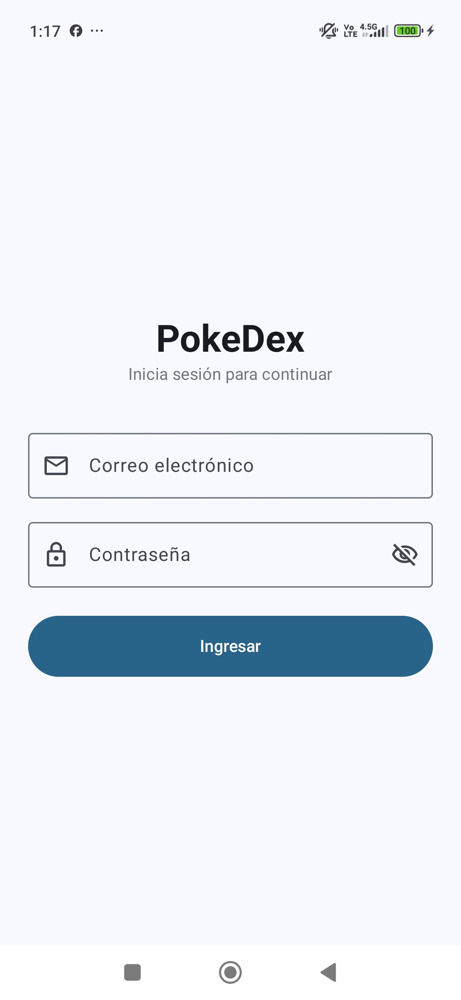</td>
    <td></td>
    <td>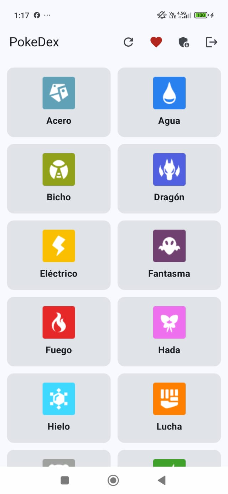</td>
  </tr>
  <tr>
    <td align="center"><b>Lista de un tipo</b></td>
    <td align="center"><b>Detalle</b></td>
    <td align="center"><b>Favoritos</b></td>
  </tr>
  <tr>
    <td>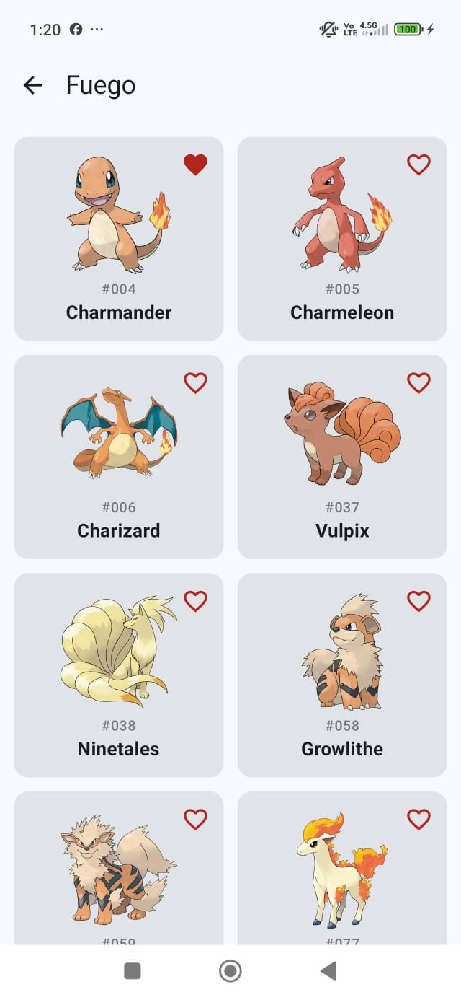</td>
    <td>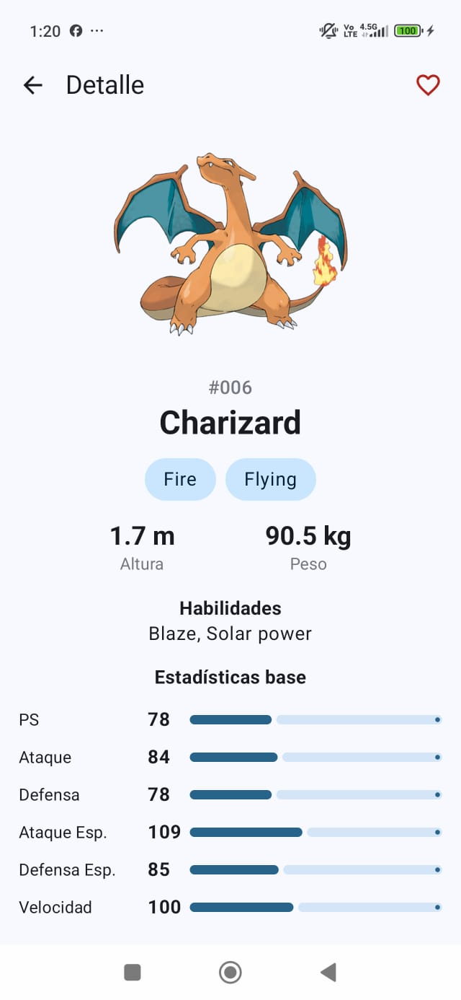</td>
    <td>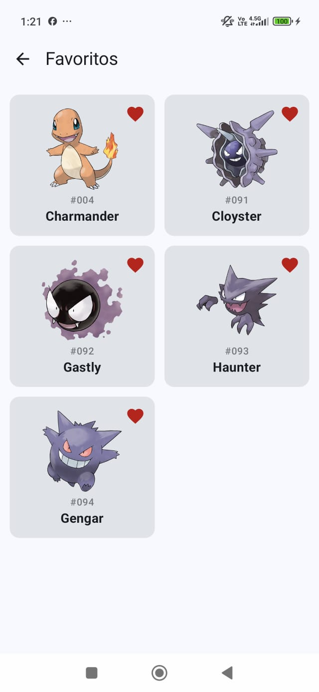</td>
  </tr>
  <tr>
    <td align="center"><b>Panel Admin</b></td>
    <td align="center"><b>Notificación</b></td>
    <td align="center"><b>Sin conexión</b></td>
  </tr>
  <tr>
    <td>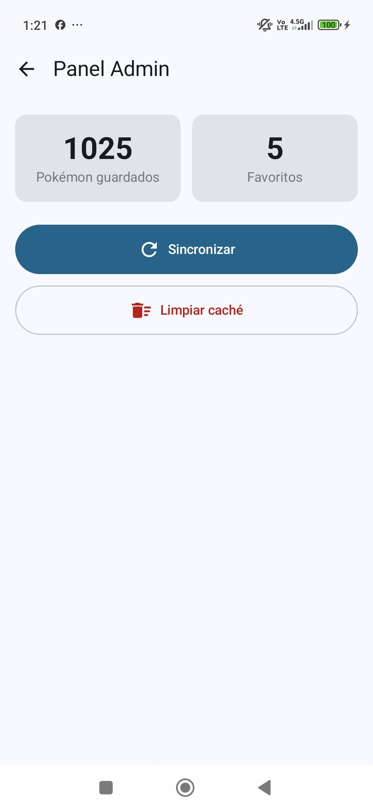</td>
    <td>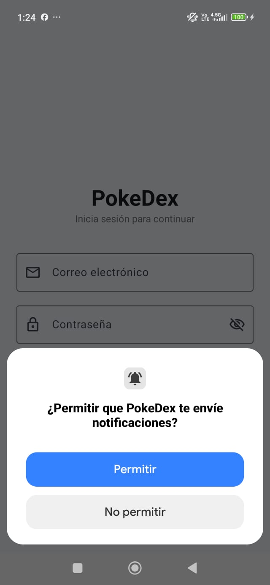</td>
    <td>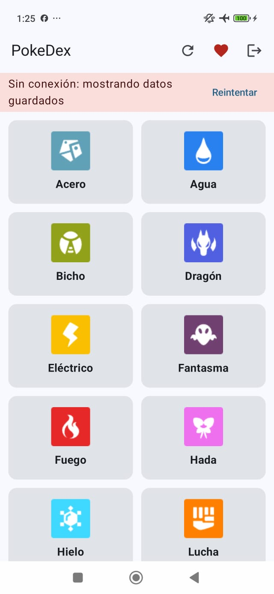</td>
  </tr>
  <tr>
    <td align="center"><b>Error sin datos</b></td>
    <td align="center"><b>Login con error</b></td>
    <td align="center"><b>Limpiar caché</b></td>
  </tr>
  <tr>
    <td>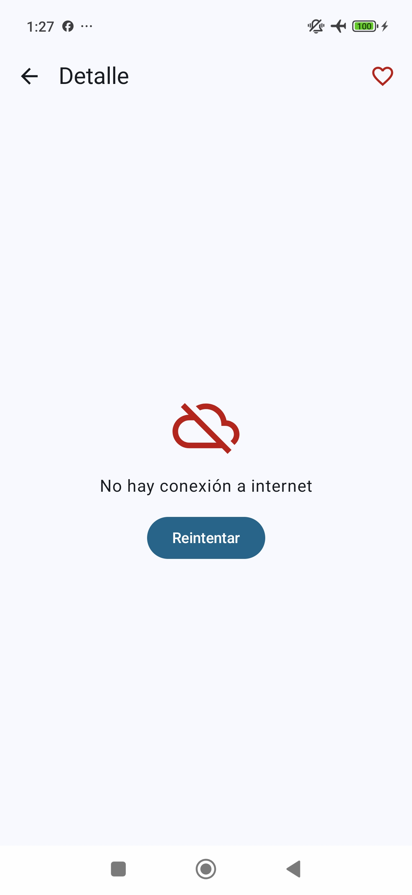</td>
    <td>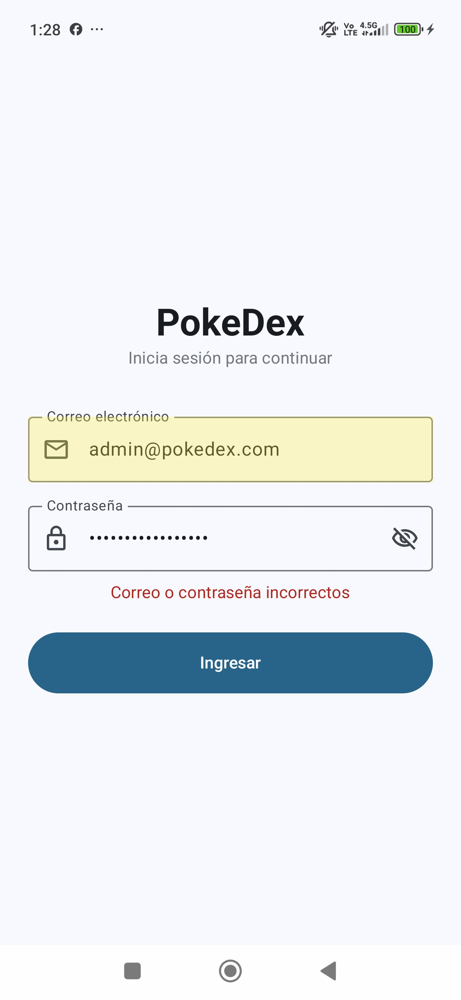</td>
    <td>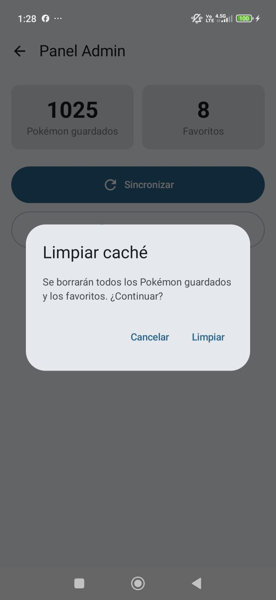</td>
  </tr>
</table>

---

## 9. Requisitos cumplidos

| Cód. | Requisito | Nivel | Dónde |
|---|---|:---:|---|
| R01 | Login con Firebase Auth, valida campos vacíos y muestra error | E | `LoginViewModel`, `LoginScreen`, `FirebaseAuthRepository` |
| R02 | Dos roles guardados en Firestore que deciden las pantallas | E | `FirebaseAuthRepository.leerSesion()`, `AppNav` |
| R03 | Lista desde Retrofit con Cargando, Error con Reintentar y Vacío | E | `TiposViewModel`, `ListaScreen`, `components/` |
| R04 | Detalle con el segundo endpoint | E | `DetalleViewModel` → `pokemon/{id}` |
| R05 | MVVM con UiState, ViewModel y Repository como interface | E | `ui/`, `data/repository/` |
| R06 | Room: Entity, Dao y Database | G | `data/local/` |
| R07 | Favoritos que se conservan al cerrar la app y al sincronizar | G | `ItemDao`, `ItemRepositoryImpl.refrescar()` |
| R08 | Sin conexión muestra lo guardado con aviso; sin datos, error con Reintentar | G | `TiposViewModel`, `TiposScreen` |
| R09 | Notificación "Se guardaron N elementos" con canal y permiso | G | `NotificadorAndroid`, `MainActivity` |
| R10 | Panel Admin: totales, Sincronizar y Limpiar caché | G | `AdminViewModel`, `AdminScreen` |
| R11 | Sesión que se mantiene y botón Cerrar sesión | G | `SesionViewModel`, `TiposScreen` |
| R12 | Pruebas unitarias del ViewModel con repositorio falso | A | Fase 2 (rama `mejora-ia`) |
| R13 | Mejora con IA documentada en `PROMPTS.md` | A | Fase 2 (rama `mejora-ia`) |

---

## 10. Pruebas de aceptación

| Cód. | Caso | Resultado esperado | Estado |
|---|---|---|:---:|
| PA-01 | Ingresar con el usuario `usuario` | Entra al catálogo y no ve el panel Admin | OK |
| PA-02 | Ingresar con el usuario `admin` | Entra al catálogo y ve el acceso al panel Admin | OK |
| PA-03 | Contraseña incorrecta | Mensaje de error claro, no entra | OK |
| PA-04 | Correo o clave vacíos | Muestra validación sin llamar a Firebase | OK |
| PA-05 | Primera apertura con internet | Cargando, luego la lista y la notificación | OK |
| PA-06 | Tocar un elemento | Detalle con datos del segundo endpoint | OK |
| PA-07 | Marcar un favorito y cerrar la app | Al reabrir sigue en Favoritos | OK |
| PA-08 | Modo avión con datos guardados | Se ve la lista con el aviso de sin conexión | OK |
| PA-09 | Modo avión sin datos (recién instalada) | Pantalla de error con Reintentar | OK |
| PA-10 | Sincronizar después de marcar un favorito | El favorito no se pierde | OK |
| PA-11 | Admin pulsa Limpiar caché | Lista vacía y totales en 0; al sincronizar vuelven | OK |
| PA-12 | Cerrar sesión y reabrir la app | Vuelve al login | OK |
| PA-13 | Girar la pantalla | No se pierde el estado ni se vuelve a descargar | OK |
| PA-14 | Negar el permiso de notificaciones | La app funciona normal, sin avisos | OK |

---

## 11. Git y commits

**Ramas:**
- `main`: Fase 1, sin IA.
- `mejora-ia`: Fase 2, con IA (pruebas, mejoras de interfaz y `PROMPTS.md`).

**Formato de los mensajes:** `tipo: qué se hizo`, con descripción por archivo en el cuerpo del commit.

| Tipo | Uso |
|---|---|
| `feat` | Algo nuevo que funciona |
| `fix` | Corrección de un error |
| `refactor` | Reorganizar sin cambiar el comportamiento |
| `test` | Pruebas |
| `docs` | Documentación |
| `chore` | Configuración |

**Hitos de la Fase 1:**

| Hito | Commit |
|---|---|
| H1 | `chore: crear proyecto base con Compose` |
| - | `chore: configurar Firebase, Retrofit, Room y dependencias` |
| H2 | `chore: crear estructura MVVM y contratos` |
| H3 | `feat: agregar componentes Cargando, Error y Vacio` |
| H4 | `feat: lista con datos de prueba` |
| - | `fix: compilar con SDK 37 requerido por core-ktx y lifecycle` |
| H5 | `feat: agregar ApiService, RetrofitClient y DTOs` |
| H6 | `feat: repositorio que consume la PokeAPI` |
| H6 | `feat: tipos y lista consumen la API` |
| H7 | `feat: pantalla de detalle` |
| H8 | `feat: base de datos Room` |
| H9 | `refactor: Room como fuente de verdad` |
| H10 | `feat: favoritos` |
| H11 | `feat: modo sin conexion` |
| H12 | `feat: repositorio de autenticacion con Firebase` |
| H13 | `feat: login con Firebase Auth` |
| H14 | `feat: roles y panel Admin` |
| H15 | `feat: notificacion local` |
| - | `feat: imagen de respaldo cuando no carga la foto` |
| H16 | `docs: README` |

**No se suben al repositorio:** `build/`, `.idea/`, `local.properties` ni `google-services.json`.

---

## 12. Reparto de tareas

Trabajo individual: todas las tareas fueron realizadas por **Daniel Millones V.**

| Área | Tareas |
|---|---|
| Configuración | Proyecto base, Gradle, Firebase (Auth, Firestore y reglas), `.gitignore` |
| Arquitectura | Estructura MVVM, contratos, `AppContainer`, `PokeDexApp` y Factory de ViewModels |
| Datos remotos | `ApiService`, `RetrofitClient`, DTOs y verificación de la PokeAPI |
| Datos locales | Entities, `ItemDao`, `AppDatabase` y mappers |
| Repositorios | `ItemRepositoryImpl` (Room como fuente de verdad) y `FirebaseAuthRepository` |
| Interfaz | Login, Tipos, Lista, Detalle, Favoritos, Panel Admin y componentes de estado |
| Funcionalidades | Favoritos, modo sin conexión, roles, sesión y notificación local |
| Documentación | README, capturas y pruebas de aceptación |