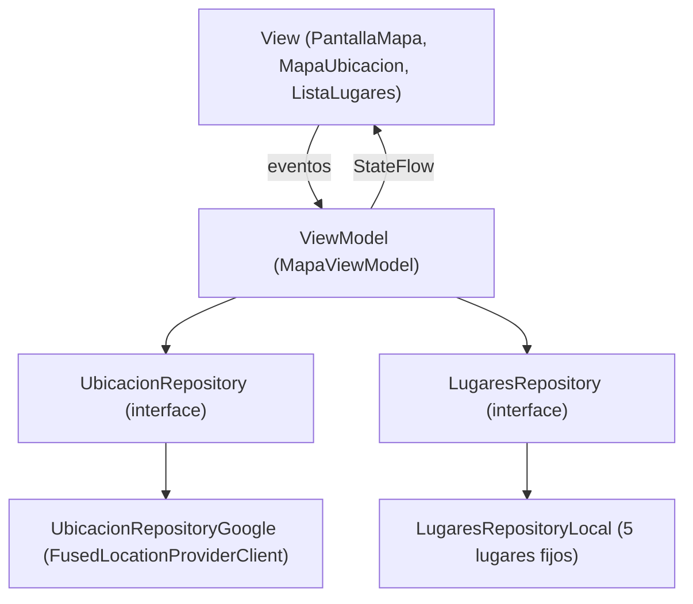
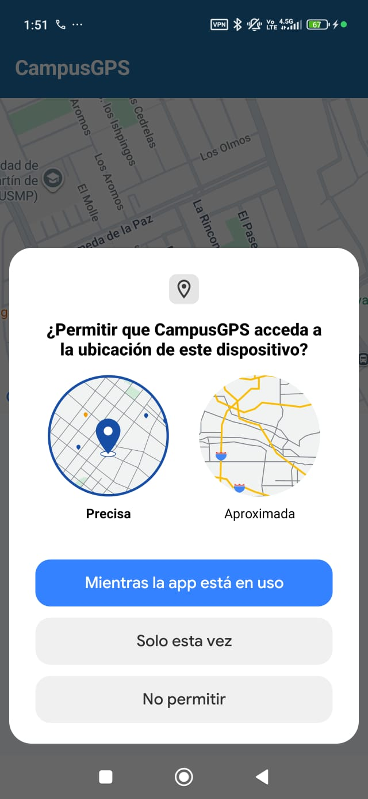
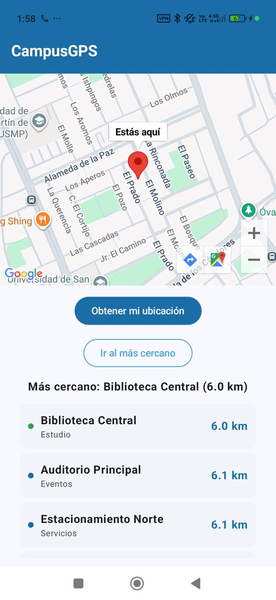
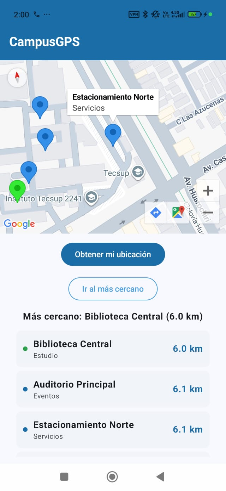
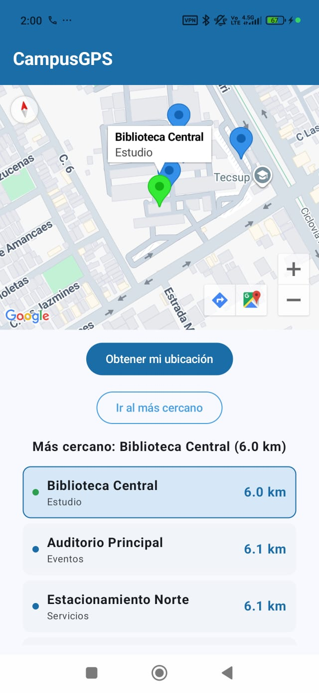
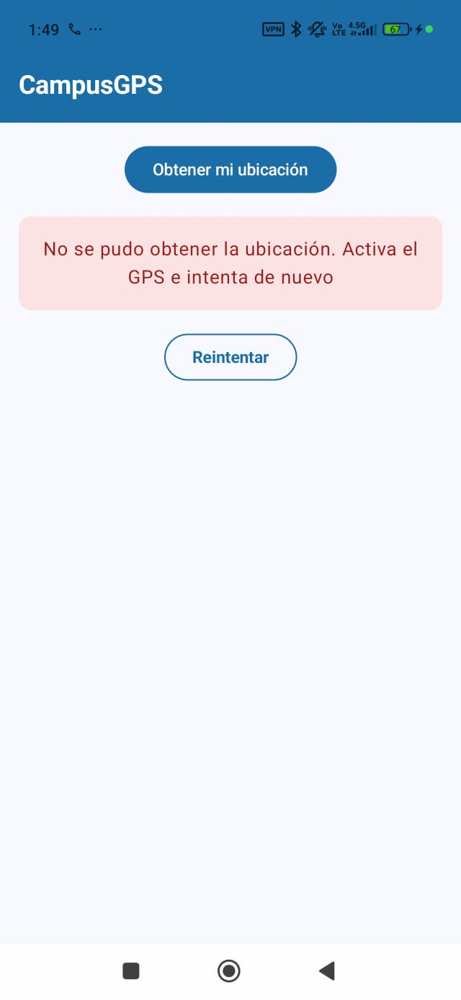

# CampusGPS

Aplicación Android que obtiene la ubicación del teléfono, la muestra en un mapa y ordena cinco lugares ficticios del campus por distancia. Trabajo del Laboratorio 13 del curso Programación en Móviles (Tecsup), docente Juan León.

## Tecnologías

Kotlin, Jetpack Compose, Material 3 (sin XML para la UI), Google Play Services Location, Maps Compose, Lifecycle ViewModel y Coroutines.

## Arquitectura

La aplicación sigue MVVM con Repository. La pantalla solo dibuja el estado que recibe del ViewModel. El ViewModel depende únicamente de interfaces de repositorio y nunca recibe un `Context`. Solo la implementación del repositorio conoce `FusedLocationProviderClient`.



Las distancias se calculan en `util/Distancia.kt` y se invocan desde el ViewModel, nunca dentro de un Composable.

## Estructura de paquetes

```
com.millones.campusgps/
├── MainActivity.kt
├── model/
│   └── Modelos.kt
├── data/
│   ├── UbicacionRepository.kt
│   ├── UbicacionRepositoryGoogle.kt
│   ├── LugaresRepository.kt
│   └── LugaresRepositoryLocal.kt
├── util/
│   ├── Distancia.kt
│   └── Formato.kt
├── viewmodel/
│   ├── MapaViewModel.kt
│   └── CampusViewModelFactory.kt
└── ui/
    ├── PantallaMapa.kt
    ├── MapaUbicacion.kt
    ├── ListaLugares.kt
    ├── MensajeError.kt
    └── theme/
```

## Capturas

|                  Permiso de ubicación                  |                     Mapa con tu ubicación                      |
|:------------------------------------------------------:|:--------------------------------------------------------------:|
|  |  |
|  **Paso 2** · Pide el permiso en tiempo de ejecución   |           **Paso 3** · Mapa con la ubicación actual            |

|                   Marcadores de los lugares                    |              Lista ordenada por distancia               |
|:--------------------------------------------------------------:|:-------------------------------------------------------:|
|  |  |
|      **Paso 4** · Marcadores azules de los cinco lugares       |    **Paso 6** · Lista ordenada y lugar seleccionado     |

|                      Error: permiso denegado                       |               Error: ubicación desactivada                |
|:------------------------------------------------------------------:|:---------------------------------------------------------:|
|  |  |
|       **Paso 8** · Permiso denegado con botón Abrir ajustes        |       **Paso 8** · GPS apagado con botón Reintentar       |

## Configuración

La clave de Google Maps no se incluye en el repositorio. Crea el archivo `local.properties` en la raíz del proyecto con esta línea:

```properties
MAPS_API_KEY=TU_CLAVE
```

La clave se inyecta en el `AndroidManifest.xml` mediante `manifestPlaceholders`. Para que funcione, la clave debe tener habilitado **Maps SDK for Android** y estar restringida al paquete `com.millones.campusgps` y a la huella SHA-1 de depuración.

## Para pensar

**1. ¿Por qué `FusedLocationProviderClient` está dentro del Repository y no en el ViewModel?** Porque es una API de Google Play Services que necesita un `Context`. Dejarla en el Repository permite que el ViewModel dependa solo de una interfaz, se pueda probar con un repositorio falso y que la implementación cambie sin tocar la lógica de la pantalla.

**2. ¿Qué diferencia hay entre el permiso de ubicación y la clave de API de Maps? ¿Qué pasa si falta cada uno?** El permiso lo concede el usuario en el teléfono y autoriza a la app a leer la ubicación del dispositivo. Sin permiso, la app no obtiene coordenadas y la pantalla muestra el mensaje de error con **Abrir ajustes**. La clave identifica la aplicación ante Google para cargar el mapa. Sin clave, el mapa no se carga y aparece un error de autorización en Logcat, pero la app sigue abierta y la lista de lugares funciona.

**3. ¿Por qué la clave va en `local.properties` y no en el código? ¿Qué harías si se subiera a GitHub por error?** `local.properties` está excluido de Git, así que la clave no entra al historial. Si se sube por error, lo primero es eliminar la clave en Google Cloud para invalidarla, crear una nueva con restricciones y revisar que el commit que la contenía no se comparta antes de corregirlo.

**4. ¿Dónde calculas la distancia y por qué no en el Composable?** La distancia se calcula en `MapaViewModel` mediante `distanciaMetros`, cuando llega la ubicación con éxito. Un Composable puede ejecutarse muchas veces durante la recomposición, así que calcular ahí repetiría trabajo y mezclaría lógica con dibujo. Al hacerlo en el ViewModel, la lista ya llega ordenada y el Composable solo la muestra.

**5. ¿Qué pasa con tu app si el usuario niega el permiso dos veces? ¿Cómo lo manejas?** Android deja de mostrar el cuadro de permiso y devuelve el resultado como denegado sin preguntar de nuevo. La app lo detecta en el callback del lanzador y llama a `permisoDenegado()`, que muestra el mensaje con el botón **Abrir ajustes**. Desde ahí el usuario puede conceder el permiso manualmente en la configuración del sistema, sin que la app se cierre.