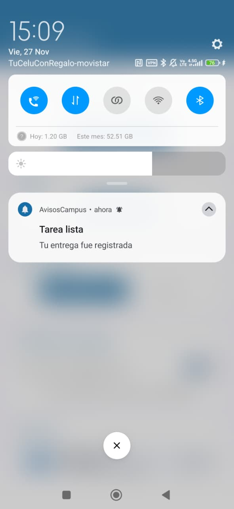
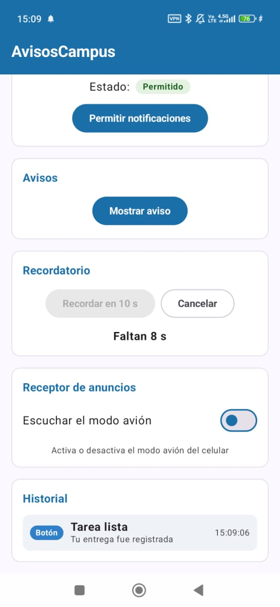
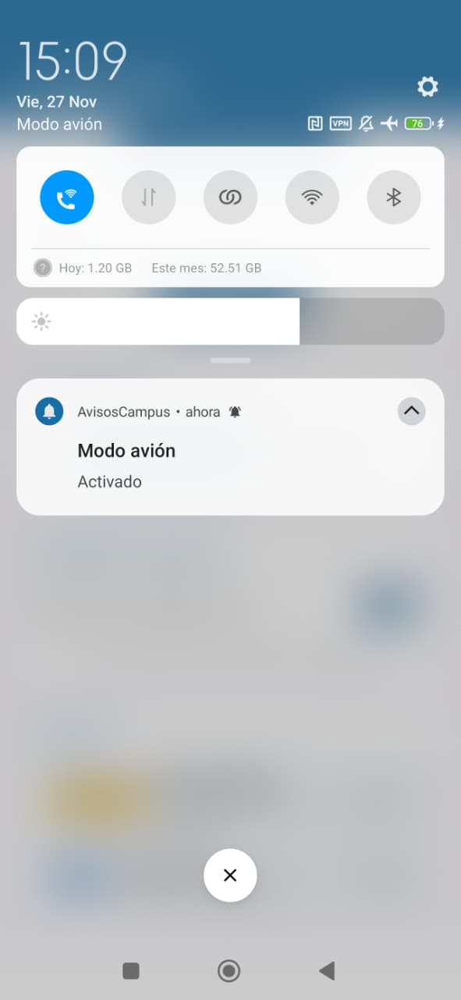
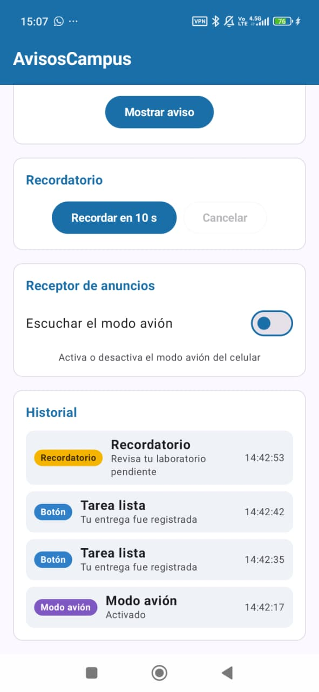
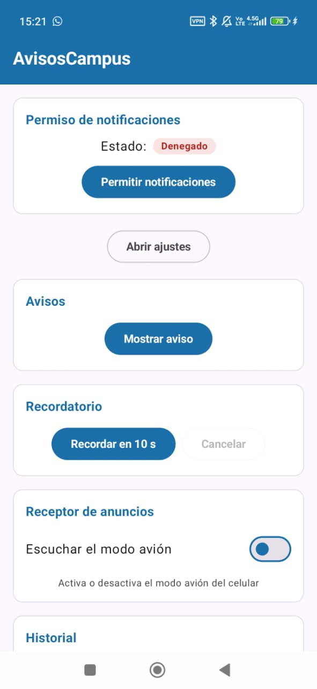

# AvisosCampus

App Android que muestra notificaciones y escucha lo que pasa en el celular. Con un botón muestra un aviso, con otro programa un recordatorio que llega a los 10 segundos, y puede avisar cuando el usuario activa o desactiva el modo avión. Todo queda anotado en un historial.

Laboratorio **GLAB-S15 · Notificaciones en Android** — Programación en Móviles (TECSUP), docente Juan León S.

| Dato | Detalle |
|---|---|
| Tecnología | Kotlin + Jetpack Compose + Material 3, notificaciones locales y BroadcastReceiver |
| Patrón | MVVM + Repository (interface) |
| SDK | minSdk 26 · targetSdk 36 · compileSdk 37 |
| Paquete | `com.millones.avisoscampus` |

---

## Estructura de paquetes

```
com.millones.avisoscampus/
├── AvisosApp.kt                  Application: crea el canal Avisos
├── MainActivity.kt               Scaffold con barra azul y PantallaAvisos
├── model/
│   └── Modelos.kt                Aviso, Origen, PermisoUi
├── data/
│   └── AvisosRepository.kt       interface + AvisosRepositoryMemoria
├── notificacion/
│   └── Notificador.kt            canal, permiso, mostrar y PendingIntent
├── receiver/
│   └── ModoAvionReceiver.kt      escucha ACTION_AIRPLANE_MODE_CHANGED
├── viewmodel/
│   ├── AvisosViewModel.kt        permiso, avisos, recordatorio, modo avión, errores
│   └── AvisosViewModelFactory.kt
└── ui/
    ├── PantallaAvisos.kt         tarjetas Permiso, Avisos, Recordatorio y Receptor
    ├── HistorialAvisos.kt        tarjeta Historial
    └── theme/                    Color, Theme, Type
```

## Arquitectura MVVM + Repository

```
View (PantallaAvisos)
   | eventos: botones, switch            ^ collectAsState()
   v                                     |
ViewModel (AvisosViewModel) --- StateFlow (avisos, permiso, faltan, mensaje, escuchandoAvion)
   | registra el aviso                   | emite: eventos (SharedFlow<Aviso>)
   v                                     v
AvisosRepository (interface)        La View recibe el evento y llama a
   -> AvisosRepositoryMemoria       Notificador.mostrar(context, aviso)
```

| Capa | Conoce a | No debe |
|---|---|---|
| View (`ui/`) | Su ViewModel y el Notificador | Decidir qué se avisa ni guardar el historial |
| ViewModel | Solo la interface del Repository | Recibir un Context ni mostrar notificaciones |
| Repository | Nada de la UI | Usar Context |
| Notificador | El sistema (canal, NotificationManager) | Guardar estado de la app |

---

## Capturas

<table>
  <tr>
    <td align="center" width="33%">
      <b>1. Notificación en el panel</b><br><br>
      
    </td>
    <td align="center" width="33%">
      <b>2. Recordatorio</b><br><br>
      
    </td>
    <td align="center" width="33%">
      <b>3. Modo avión</b><br><br>
      
    </td>
  </tr>
  <tr>
    <td align="center" width="33%">
      <b>4. Historial</b><br><br>
      
    </td>
    <td align="center" width="33%">
      <b>5. Permiso denegado</b><br><br>
      
    </td>
    <td></td>
  </tr>
</table>

---

## Pruebas de aceptación (Android 13+)

| Prueba | Resultado esperado | OK |
|---|---|---|
| Ajustes → Apps → AvisosCampus → Notificaciones | Existe el canal Avisos | ✅ |
| Pulsar Permitir notificaciones | Aparece el cuadro de Android y la etiqueta cambia | ✅ |
| Pulsar Mostrar aviso | Aparece la notificación Tarea lista | ✅ |
| Pulsar Mostrar aviso dos veces | Aparecen dos notificaciones distintas | ✅ |
| Tocar la notificación | Se abre la app y la notificación desaparece | ✅ |
| Recordar en 10 s | Cuenta regresiva y aviso al llegar a 0 | ✅ |
| Recordar y minimizar la app | El aviso llega igual | ✅ |
| Recordar y cancelar | No llega ningún aviso | ✅ |
| Switch activado y cambiar el modo avión | Aviso Activado y luego Desactivado | ✅ |
| Switch desactivado y cambiar el modo avión | No hay aviso | ✅ |
| Permiso denegado y Mostrar aviso | Mensaje de error, aviso en el historial y la app no se cierra | ✅ |
| Rotar la pantalla durante el recordatorio | La cuenta regresiva continúa | ✅ |
| Revisar el código | No hay Context en `viewmodel/` y todo receptor se quita en `onDispose` | ✅ |

---

## Para pensar

**1. ¿Por qué una notificación necesita un canal y un permiso? ¿Qué pasa si falta cada uno?**
Desde Android 8 cada notificación pertenece a un canal, y el usuario controla en Ajustes la importancia, el sonido y si se muestra cada canal. Sin canal, la notificación no aparece en Android 8 o superior. Desde Android 13, `POST_NOTIFICATIONS` es un permiso en tiempo de ejecución que decide si la app puede notificar. Sin permiso, `notify` no muestra nada; por eso `Notificador.mostrar` lo revisa primero y devuelve `false`.

**2. ¿Por qué el ViewModel emite un evento y no muestra la notificación él mismo?**
Para mostrar una notificación hace falta un `Context`, y el ViewModel no debe tenerlo: vive más que la Activity y podría filtrar memoria. Además, quedaría atado a Android y no se podría probar sin el sistema. El ViewModel decide qué avisar, lo guarda en el Repository y emite el evento; la pantalla, que sí tiene Context, llama al `Notificador`.

**3. ¿Qué pasa si usas el mismo id en dos notificaciones?**
La segunda reemplaza a la primera, así que en el panel solo se ve una. Por eso se usa `aviso.id`, que el Repository incrementa, y cada aviso es una notificación distinta.

**4. ¿Por qué onReceive debe ser corto y por qué hay que quitar el receptor al salir?**
`onReceive` corre en el hilo principal y Android le da poco tiempo: un trabajo largo congela la app o provoca un ANR. Por eso solo entrega el estado con `alCambiar`. El receptor se quita en `onDispose` porque, si queda registrado, mantiene viva la referencia a la pantalla (fuga de memoria) y seguiría recibiendo anuncios aunque el switch esté apagado.

**5. ¿En qué casos usarías una notificación local y en cuáles una push de Firebase?**
Una notificación local sirve cuando la propia app sabe lo que va a pasar: un recordatorio programado, una tarea terminada o un cambio en el celular. Una push de Firebase sirve cuando el aviso nace en un servidor o en otra persona: un mensaje nuevo, una nota publicada por el docente o una alerta de un sistema externo, incluso con la app cerrada.

---

## Repositorio

🔗 https://github.com/DMillonnesZ/Moviles-Seccion-D/tree/main/Semana%2015
