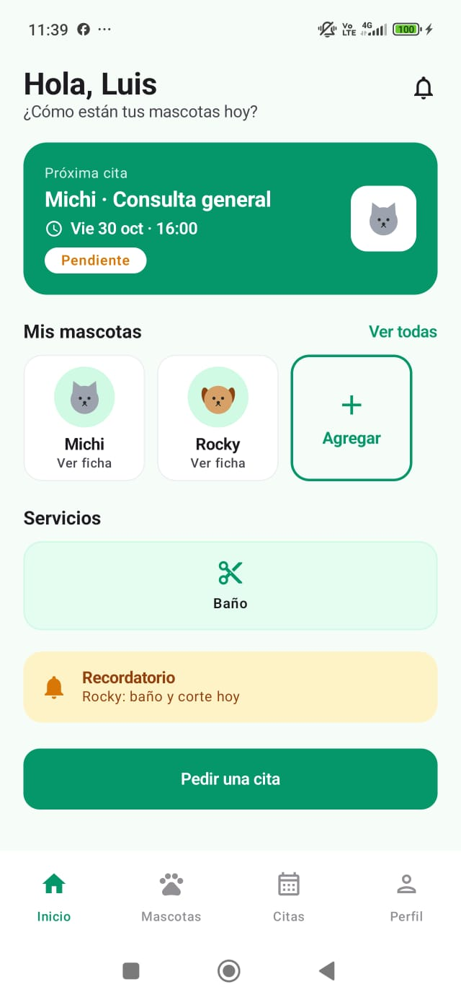
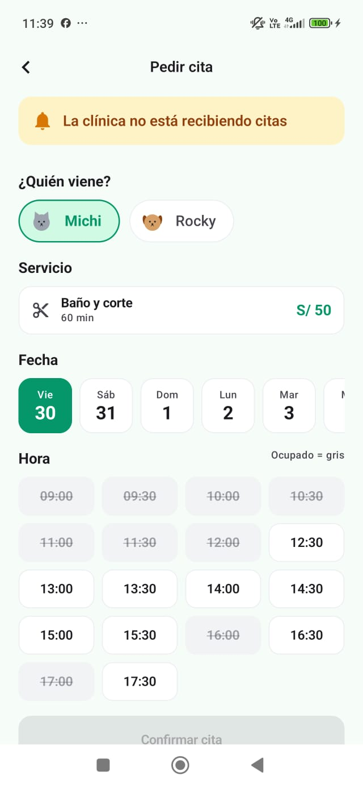
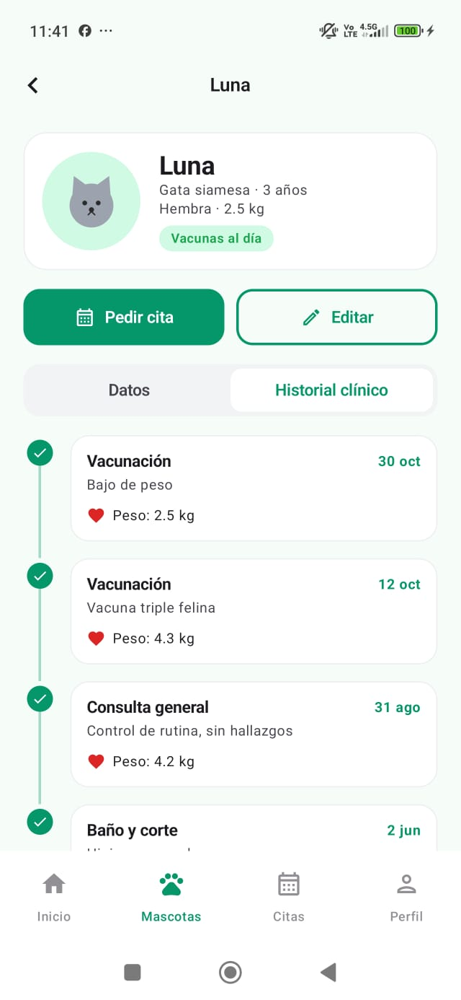
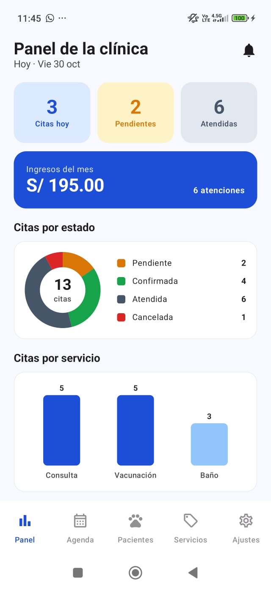
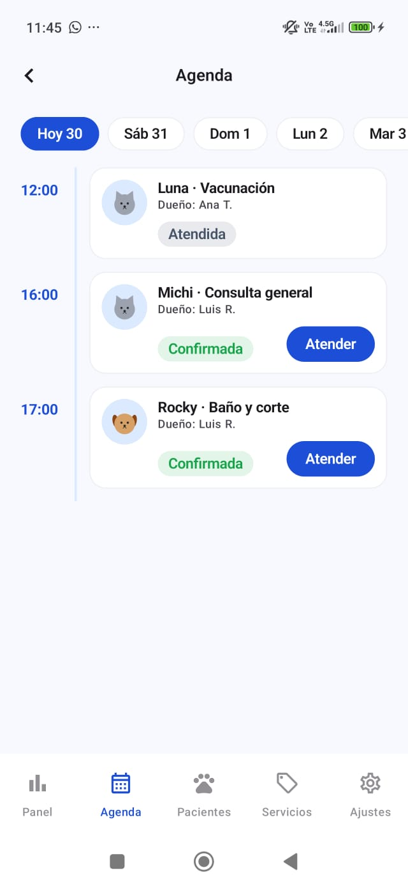
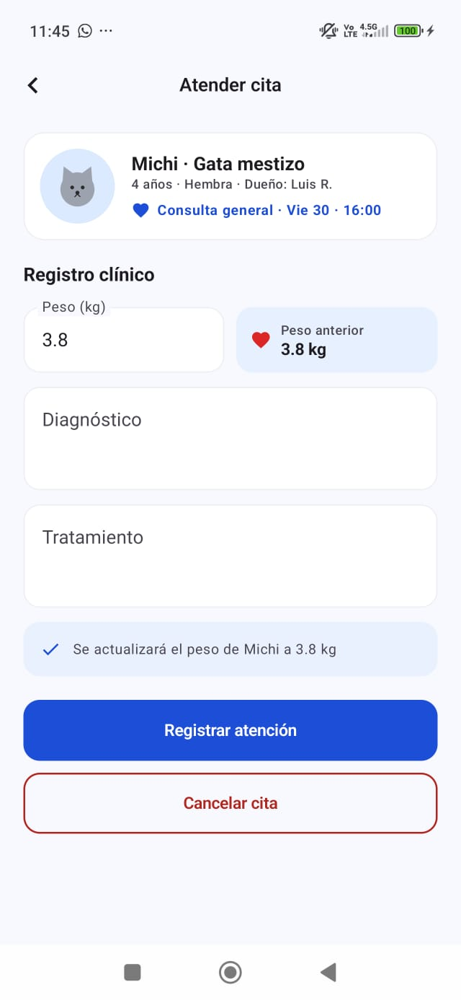

# 🐾 HuellitasVet

**Laboratorio 08 · MVVM + Room** — Programación en Móviles (TECSUP, 4to ciclo)
Docente: Juan León S.

App Android de una veterinaria con **dos perfiles en el mismo dispositivo**:

- 💚 **Dueño**: registra a sus mascotas, pide citas eligiendo servicio, fecha y hora, y consulta el historial clínico de cada mascota.
- 💙 **Veterinario**: ve el panel y la agenda, confirma citas, registra la atención (diagnóstico, tratamiento y peso), consulta a los pacientes y administra los servicios.

Ambos perfiles comparten la misma base de datos **Room**: cuando el veterinario registra una atención, el dueño la ve al instante en el historial de su mascota.

> Datos ficticios (Ley 29733): nombres, correos y mascotas inventados.

---

## 🛠️ Tecnologías

| Tecnología | Uso |
|---|---|
| Kotlin + Jetpack Compose + Material 3 | UI sin XML |
| Room | Base de datos local `huellitasvet.db` (4 tablas) |
| DataStore Preferences | Perfil activo, modo oscuro, notificaciones, aceptar citas |
| Navigation Compose | Navegación y barra inferior por rol |
| `java.time` (minSdk 26) | Fechas y horas (`LocalDate`, `LocalTime`) |
| Canvas | Avatar de mascotas y gráficos (dona y barras) |

### ⚠️ Versiones distintas al PDF (y por qué)

| PDF | Proyecto | Motivo |
|---|---|---|
| KSP `2.0.21-1.0.28` | KSP `2.3.10` | El proyecto usa **AGP 9** (Kotlin integrado); KSP 2.3.x es el compatible |
| Room `2.6.1` | Room `2.8.4` | Compatibilidad con KSP 2.3.x. El código (`@Entity`, `@Dao`, `withTransaction`) es el mismo |
| compileSdk 36 | compileSdk **37** | `lifecycle 2.11` exige compilar con API 37 (targetSdk 36 y minSdk 26 no cambian) |

---

## 🔑 Usuarios de prueba

| Perfil | Correo | Clave |
|---|---|---|
| Dueño | `ana@correo.test` | `1234` |
| Dueño | `luis@correo.test` | `1234` |
| Veterinario | `vet@huellitas.test` | `admin` |

---

## 🏛️ Arquitectura MVVM + Repository

```
VIEW (Composable)
   │ eventos (clics)          ▲ collectAsState()
   ▼                          │
VIEWMODEL (StateFlow + reglas de negocio)
   │ llama                    ▲ Flow / resultados
   ▼                          │
VetRepository (interface = contrato)
   │ la implementa
   ▼
VetRepositoryRoom ──► DAO ──► SQLite (huellitasvet.db)

DataStore (solo preferencias) ──► ViewModel
```

| Capa | Conoce a | NO debe |
|---|---|---|
| View (`ui/`) | Solo a su ViewModel | Usar DAO, Repository ni reglas de negocio |
| ViewModel | Solo al Repository (interface) | Conocer Composables ni el DAO |
| Repository | Los DAOs (en la implementación) | Conocer pantallas ni ViewModels |
| DAO / Room | SQL y entidades | Conocer ViewModels |

**Regla de oro:** lectura que debe actualizar la pantalla → `Flow` (sin `suspend`). Escritura o acción única → `suspend`.

---

## 🗄️ Base de datos (4 tablas)

```
usuarios 1 ──── N mascotas 1 ──── N citas N ──── 1 servicios
```

| Tabla | Columnas clave |
|---|---|
| `usuarios` | id, nombre, correo, clave, rol (CLIENTE \| ADMIN) |
| `servicios` | id, nombre, descripcion, duracionMin, precio, activo, icono |
| `mascotas` | id, duenoId (FK), nombre, especie, raza, anioNacimiento, peso, sexo |
| `citas` | id, mascotaId (FK), servicioId (FK), fecha, hora, nota, estado, precio, diagnostico?, tratamiento?, pesoRegistrado?, fechaCreacion |

- Índices en cada FK + índice compuesto `(fecha, hora)` para los horarios ocupados.
- `CitaConDetalle` = relación **anidada** (cita → mascota → dueño) + servicio, con `@Transaction`.
- `registrarAtencion` usa `db.withTransaction { }`: la cita pasa a ATENDIDA **y** se actualiza el peso de la mascota en una sola operación.

---

## 📁 Estructura de paquetes

```
com.tecsup.huellitasvet
├── MainActivity.kt
├── VetApp.kt                      crea la base, el repository y las preferencias
│
├── data
│   ├── local
│   │   ├── entity                 Servicio · Usuario · Mascota · Cita
│   │   ├── dao                    ServicioDao · UsuarioDao · MascotaDao · CitaDao
│   │   ├── relation               MascotaConDueno · CitaConDetalle
│   │   ├── VetDatabase.kt
│   │   └── DatosIniciales.kt
│   ├── repository
│   │   ├── VetRepository.kt       interface (contrato)
│   │   └── VetRepositoryRoom.kt   implementación con Room
│   └── prefs
│       └── PreferenciasStore.kt   DataStore
│
├── model                          Rol · EstadoCita · Especie · Sexo · ConteoServicio · Horarios · UltimaVisita
│
├── viewmodel
│   ├── VetViewModelFactory.kt
│   ├── SesionViewModel.kt         ServiciosViewModel.kt
│   ├── InicioViewModel.kt         MascotaViewModel.kt
│   ├── PedirCitaViewModel.kt      MisCitasViewModel.kt
│   ├── PanelViewModel.kt          AgendaViewModel.kt
│   └── AtenderCitaViewModel.kt    PacientesViewModel.kt
│
└── ui
    ├── theme                      Color · Type · Theme (VetTheme por rol + modo oscuro)
    ├── components                 AppTopBar · VetButton · VetTextField · EstadoCitaChip
    │   │                          MascotaAvatar · CitaCard · FechaChip · HoraChip
    │   │                          HistorialItem · ServicioItem · PerfilComponentes
    │   └── graficos               DatoGrafico · GraficoDona · GraficoBarras
    ├── navigation                 Rutas · NavVet · BarraInferior
    ├── dueno                      Splash · Login · Inicio · Mascotas · FormularioMascota
    │                              FichaMascota · PedirCita · MisCitas · Perfil
    └── veterinario                Panel · Agenda · AtenderCita · Pacientes
                                   Servicios · FormularioServicio · Ajustes
```

### Archivos extra (no estaban en la estructura del PDF)

| Archivo | Motivo |
|---|---|
| `components/ServicioItem.kt` | Tarjeta de servicio reutilizable (la usa el ejemplo resuelto) |
| `components/PerfilComponentes.kt` | Piezas comunes de Perfil y Ajustes (tarjeta de usuario, preferencias, cerrar sesión) |
| `navigation/BarraInferior.kt` | Barra inferior: 4 ítems para el dueño y 5 para el veterinario |
| `model/UltimaVisita.kt` | Resultado de la consulta "última visita" de Pacientes |

### Funciones agregadas al Repository (declaradas primero en la interface)

- `obtenerUsuario(id)` → recordar la sesión al reabrir la app.
- `obtenerUsuarioPorRol(rol)` → cambio de perfil (modo práctica).
- `observarUltimasVisitas()` → "Última visita" en Pacientes.

### Mejora: `guardarServicio` y `guardarMascota`

Usan `insertar` si `id == 0` y `actualizar` si no. **No** se usa solo `REPLACE`, porque `REPLACE` borra y vuelve a insertar la fila, y si el servicio o la mascota ya tiene citas, la clave foránea lo bloquea.

---

## 📏 Reglas de negocio (en los ViewModels)

| Regla | Detalle |
|---|---|
| Visibilidad | El dueño solo ve sus mascotas y sus citas. El veterinario ve todo |
| Registrar mascota | Nombre ≥ 2, especie y sexo elegidos, año 1990–actual, peso > 0 |
| Eliminar mascota | Solo si no tiene citas |
| Pedir cita | Servicio activo, de hoy a 7 días, 09:00–17:30 cada 30 min, si es hoy solo horas futuras, estado PENDIENTE, guarda el precio |
| Horario único | Un horario ocupado (no cancelado) aparece gris y tachado |
| Cancelar (dueño) | Solo PENDIENTE o CONFIRMADA y con más de 2 horas de anticipación |
| Estados (veterinario) | PENDIENTE → CONFIRMADA · PENDIENTE/CONFIRMADA → CANCELADA · ATENDIDA solo registrando la atención |
| Registrar atención | Diagnóstico ≥ 5 y peso > 0, en una transacción |
| Servicios | Con citas no se elimina (solo se desactiva). Inactivo no aparece al pedir cita |
| Aceptar citas | Si está apagado, el dueño ve "La clínica no está recibiendo citas" |

---

## 📸 Capturas

### 💚 Dueño

| Inicio | Pedir cita | Ficha e historial |
|---|---|---|
|  |  |  |

### 💙 Veterinario

| Panel | Agenda | Atender cita |
|---|---|---|
|  |  |  |

---

## ✅ Pruebas de aceptación

| Prueba | Resultado esperado | OK |
|---|---|---|
| Login con clave incorrecta | Mensaje de error, no entra | ✅ |
| Dueño: registrar mascota sin nombre | Errores junto a cada campo, no se guarda | ✅ |
| Dueño: eliminar una mascota con citas | Mensaje de aviso y no se elimina | ✅ |
| Dueño: pedir cita | Aparece en Mis citas como PENDIENTE y con el precio del servicio | ✅ |
| Dueño: elegir un horario ocupado | El horario aparece gris y no se puede elegir | ✅ |
| Veterinario: agenda | La cita aparece en su hora y puede confirmarla; el dueño la ve CONFIRMADA | ✅ |
| Veterinario: atender una cita | Pasa a ATENDIDA, el dueño la ve en el historial y el peso se actualizó | ✅ |
| Dueño: cancelar una cita a menos de 2 horas | No se permite cancelar | ✅ |
| Veterinario: ingresos del mes | Coinciden con la suma del precio de las citas atendidas | ✅ |
| Veterinario: desactivar un servicio | Ya no se puede elegir al pedir una cita | ✅ |
| Veterinario: eliminar un servicio con citas | No se elimina; se muestra un mensaje | ✅ |
| Cerrar y abrir la app | Las citas siguen ahí y el perfil y el modo oscuro se recuerdan | ✅ |

---

## 🌿 Ramas

| Rama | Contenido |
|---|---|
| `main` / `sin-ia` | Fase 1 — construida paso a paso, un commit por paso |
| `mejora-ia` | Fase 2 — mejoras con Gemini (ver `PROMPTS.md`) |