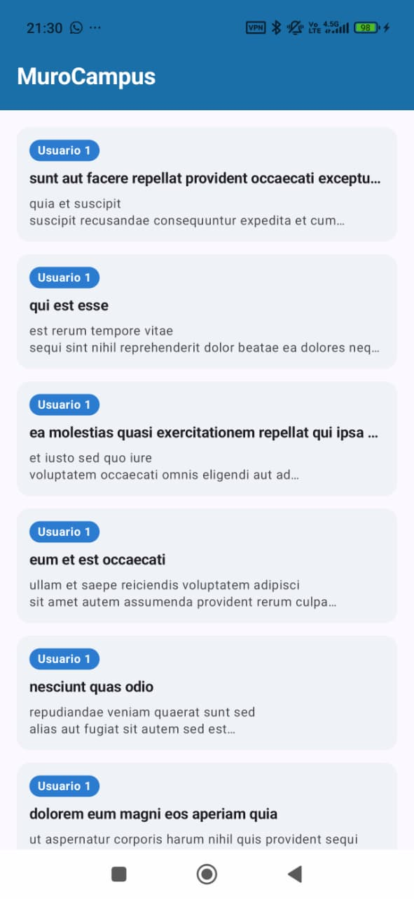
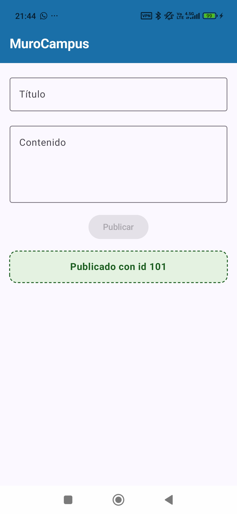

# MuroCampus

App Android hecha con Jetpack Compose que consume el servicio web REST
[JSONPlaceholder](https://jsonplaceholder.typicode.com/). Lista publicaciones,
muestra el detalle con sus comentarios, filtra por usuario y crea una
publicación nueva. Muestra los estados Cargando, Éxito y Error, y se comporta
bien cuando no hay internet.

**Stack:** Kotlin, Compose, Retrofit, OkHttp, kotlinx.serialization,
ViewModel + StateFlow, arquitectura MVVM + Repository.

## Estructura de paquetes

```
com.millones.murocampus/
├── MainActivity.kt
├── model/
│   └── Modelos.kt              Usuario, Post, Comentario, NuevoPost
├── data/
│   ├── remote/
│   │   ├── PostApi.kt          interface de Retrofit
│   │   ├── UsuarioApi.kt       ejemplo resuelto
│   │   └── RetrofitClient.kt   cliente creado una sola vez
│   ├── PostRepository.kt       interface + PostRepositoryRemote
│   └── UsuarioRepository.kt    ejemplo resuelto
├── viewmodel/
│   ├── UiState.kt              Cargando / Exito / Error + mensajeDe
│   ├── PostsViewModel.kt
│   └── PostsViewModelFactory.kt
└── ui/
    ├── Componentes.kt          TarjetaPost, Cargando, ErrorConReintento
    ├── PantallaLista.kt
    ├── PantallaDetalle.kt
    ├── PantallaCrear.kt
    └── theme/
```

## Arquitectura MVVM + Repository

```
View (PantallaLista, PantallaDetalle, PantallaCrear)
   | eventos: cargar, filtrar, publicar        ^ collectAsStateWithLifecycle()
   v                                           |
ViewModel (PostsViewModel) --- StateFlow<UiState> (Cargando / Exito / Error)
   | viewModelScope.launch
   v
PostRepository (interface)  <- devuelve Result<...>
   -> PostRepositoryRemote (captura IOException, HttpException...)
   |
   v
PostApi (Retrofit) --- OkHttp ---> https://jsonplaceholder.typicode.com/
```

## Capturas

<table>
  <tr>
    <td align="center"><b>Lista</b><br></td>
    <td align="center"><b>Detalle</b><br></td>
    <td align="center"><b>Filtro</b><br></td>
  </tr>
  <tr>
    <td align="center"><b>Crear</b><br></td>
    <td align="center"><b>Error de conexión</b><br></td>
    <td></td>
  </tr>
</table>

## Para pensar

**1. ¿Qué diferencia hay entre GET y POST? ¿Por qué crear lleva `@Body` y
`porUsuario` lleva `@Query`?**
GET lee datos y no cambia nada en el servidor; POST envía datos para crear un
recurso. `crear` lleva `@Body` porque la publicación viaja como JSON en el
cuerpo de la petición. `porUsuario` lleva `@Query` porque es un filtro que se
agrega a la URL (`posts?userId=2`) y no hay nada que enviar en el cuerpo.

**2. ¿Por qué la ruta es `"posts"` y no `"/posts"`?**
Porque una barra inicial reemplaza todo el camino de la URL base. Con
`"posts"`, Retrofit la une a la `baseUrl` y respeta su ruta; con `"/posts"` la
descartaría.

**3. ¿Por qué el Repository devuelve `Result` en vez de dejar que la excepción
llegue al ViewModel?**
Para que el ViewModel no conozca los detalles de la red (`HttpException`,
`IOException`). El Repository convierte cualquier falla en `Result.failure` y
el ViewModel solo decide qué estado mostrar. Así la capa de datos se puede
cambiar sin tocar el ViewModel ni las pantallas.

**4. ¿Qué pasa si olvidas el permiso INTERNET? ¿Y si olvidas
`ignoreUnknownKeys` y el servidor agrega un campo nuevo?**
Sin el permiso, la app compila pero nunca se conecta y falla con un error de
red aunque haya internet. Sin `ignoreUnknownKeys`, un campo nuevo que el
modelo no declara hace fallar el parseo con `SerializationException`, y la app
dejaría de funcionar sin que el código haya cambiado.

**5. ¿Por qué la pantalla de lista usa un `when` sobre `UiState` y no un `if`
con tres variables?**
Porque `UiState` es una `sealed interface`: el compilador obliga a cubrir los
tres casos y evita estados imposibles, como estar cargando y con error a la
vez. Con tres variables sueltas habría que mantenerlas sincronizadas a mano.

**6. JSONPlaceholder no guarda los POST. ¿Cómo cambiaría tu app si usaras un
servicio real?**
Al crear una publicación, la lista debería refrescarse (o insertar la
publicación nueva) para que aparezca. También habría que manejar
autenticación, validaciones del servidor y el `userId` real del usuario en
sesión, en lugar del 1 fijo.