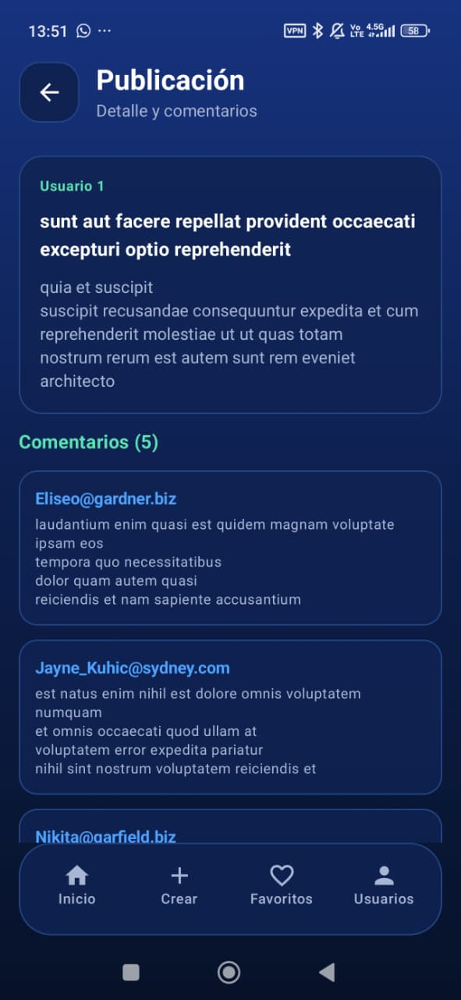
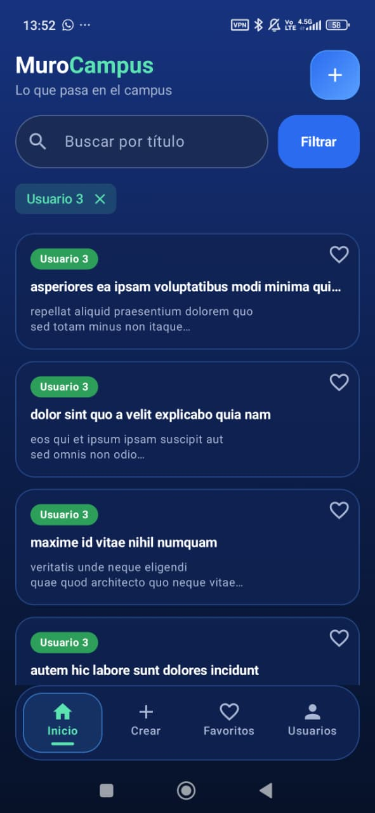
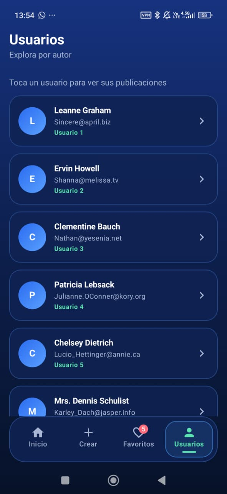
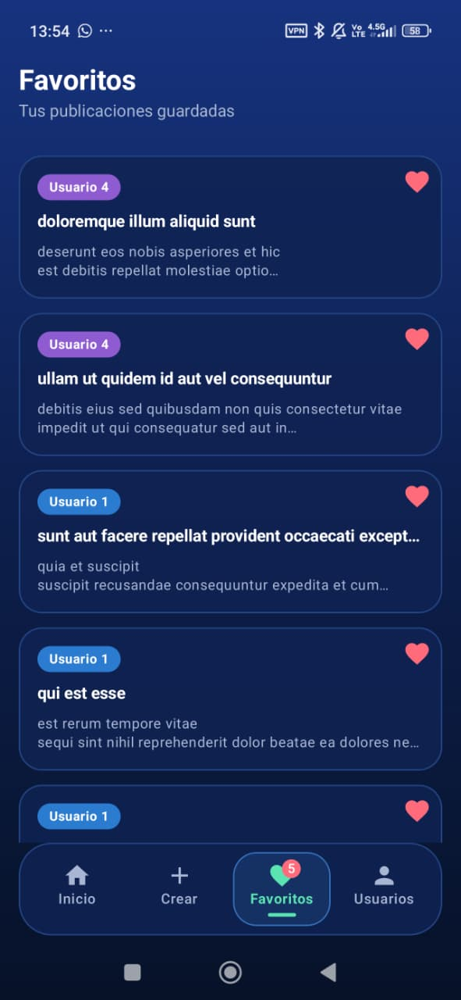

# MuroCampus 🚀

App Android moderna construida con **Jetpack Compose** que consume el servicio web REST [JSONPlaceholder](https://jsonplaceholder.typicode.com/). 

En esta versión (**Fase 2 · Mejoras con IA** - rama `mejora-ia`), la aplicación ha sido repotenciada con una arquitectura robusta, interfaz de usuario estilo *Glassmorphism*, sistema de búsqueda, paginación dinámica, borrado de publicaciones con `@DELETE`, gestión de favoritos y navegación multinivel por usuarios.

---

## 🌟 Novedades y Mejoras asistidas por IA (Fase 2)

- 🗑️ **Borrado de publicaciones (`@DELETE`)**: 
  - Integración del endpoint `@DELETE("posts/{id}")` con `Response<Unit>` en Retrofit para validar códigos HTTP (como 200/204) sin lanzar excepciones no deseadas.
  - UI interactiva mediante deslizamiento de tarjeta (*SwipeToDismissBox*) o cuadro de diálogo modal de confirmación.
  - Eliminación sincronizada que remueve la publicación tanto de la lista remota/local como del mapa de favoritos.

- 🔍 **Búsqueda en tiempo real por Título**:
  - Campo de búsqueda `OutlinedTextField` integrado en la barra superior.
  - Filtrado instantáneo (case-insensitive) sobre las publicaciones cargadas sin saturar el servidor con peticiones innecesarias.

- 📄 **Paginación Dinámica (Lotes de 20)**:
  - Consumo del servicio paginado `@GET("posts")` usando parámetros `@Query("_start")` y `@Query("_limit")`.
  - Carga diferida con botón *"Cargar más"* e indicador visual de progreso (`CircularProgressIndicator`).

- ❤️ **Sistema de Favoritos en Memoria**:
  - Posibilidad de marcar/desmarcar cualquier publicación con un ícono de corazón.
  - Pestaña dedicada a Favoritos con contador en vivo (*Badge*) en la barra de navegación inferior.

- 👤 **Exploración por Usuarios**:
  - Pestaña *"Usuarios"* conectada a `UsuarioApi` y `UsuariosViewModel`.
  - Permite visualizar la lista de usuarios y filtrar el feed principal automáticamente al seleccionar a un autor específico.

- 🎨 **UI/UX Elevada (Glassmorphism & Animaciones)**:
  - Diseño oscuro con efectos de cristal esmerilado (`vidrio()`), paleta de colores personalizada (Azul, Menta, TarjetaGris).
  - Animación de celebración personalizada (`ExitoAnimado`) con confeti al realizar acciones exitosas como crear o eliminar publicaciones.

---

## 🛠️ Stack Tecnológico

- **Lenguaje:** Kotlin
- **UI Framework:** Jetpack Compose (Material 3)
- **Asincronía & Estado:** Corrutinas, Flow, StateFlow, `collectAsStateWithLifecycle`
- **Arquitectura:** MVVM (Model-View-ViewModel) + Repository Pattern
- **Red:** Retrofit 2, OkHttp 4
- **Serialización:** `kotlinx.serialization` (JSON)

---

## 📁 Estructura de Paquetes

```
com.millones.murocampus/
├── MainActivity.kt               # Scaffold principal, navegación por pestañas y snackbars
├── model/
│   └── Modelos.kt                # Data classes: Usuario, Post, Comentario, NuevoPost
├── data/
│   ├── remote/
│   │   ├── PostApi.kt            # Interface Retrofit (GET, POST, DELETE, Paginación)
│   │   ├── UsuarioApi.kt         # Interface Retrofit para Usuarios
│   │   └── RetrofitClient.kt     # Cliente Singleton con kotlinx.serialization
│   ├── PostRepository.kt         # Interface + PostRepositoryRemote (Result<T> & Response<Unit>)
│   └── UsuarioRepository.kt      # Interface + UsuarioRepositoryRemote
├── viewmodel/
│   ├── UiState.kt                # Sealed interface: Cargando, Exito, Error + EventoUi
│   ├── PostsViewModel.kt         # Gestión de publicaciones, búsqueda, filtros, favoritos y borrado
│   ├── PostsViewModelFactory.kt  # Inyección de dependencias para PostsViewModel
│   └── UsuariosViewModel.kt      # ViewModel + Factory para la lista de usuarios
└── ui/
    ├── Componentes.kt            # TarjetaPost, Botones, Cargando, ErrorConReintento
    ├── TarjetaConCorazon.kt      # Tarjeta interactiva con acción de favorito
    ├── Estilo.kt                 # Modificadores de Glassmorphism (vidrio) y formas
    ├── ExitoAnimado.kt           # Animación overlay de éxito con confeti
    ├── PantallaLista.kt          # Feed principal (búsqueda, filtro, paginación y SwipeToDismiss)
    ├── PantallaDetalle.kt         # Vista detallada de la publicación y comentarios
    ├── PantallaCrear.kt          # Formulario para publicar nuevos posts
    ├── PantallaFavoritos.kt       # Pestaña de publicaciones guardadas
    ├── PantallaUsuarios.kt        # Listado de usuarios del campus
    └── theme/                    # Color.kt, Theme.kt, Type.kt
```

---

## 🏗️ Arquitectura del Proyecto

```
View (Pantallas Compose)
   │  Eventos: buscar, filtrar, publicar, borrar, alternarFavorito, cargarMas
   ▼
ViewModel (PostsViewModel / UsuariosViewModel) ─── StateFlow<UiState / EventoUi>
   │  viewModelScope.launch (Corrutinas + async/await)
   ▼
Repository (PostRepository / UsuarioRepository)  ◄── Retorna Result<T>
   │  Manejo centralizado de excepciones (CancellationException, HttpException, IOException)
   ▼
API Client (PostApi / UsuarioApi - Retrofit) ── OkHttp ──► REST API (JSONPlaceholder)
```

---

## 📸 Capturas de Pantalla

| Feed Principal (Lista) | Detalle y Comentarios | Filtro por Autor |
| :---: | :---: | :---: |
|  |  |  |

| Lista de Usuarios | Publicaciones Favoritas | Crear Publicación | Error de Conexión |
| :---: | :---: | :---: | :---: |
|  |  |  |  |

---

## 🧠 Análisis Técnico y Preguntas de Reflexión

### 1. ¿Por qué usar `@DELETE("posts/{id}")` retornando `Response<Unit>` en lugar de `Unit` directo?
Al usar `Response<Unit>`, Retrofit nos entrega la respuesta HTTP completa sin lanzar automáticamente una `HttpException` ante códigos de error (ej. 404 o 500). Esto permite que el Repositorio analice `respuesta.isSuccessful` antes de proceder, garantizando un control explícito sobre el resultado de la operación.

### 2. ¿Cómo maneja la aplicación los datos locales frente al servicio REST ficticio?
Como JSONPlaceholder no almacena las peticiones `POST` ni ejecuta borrados reales en el backend, el `PostsViewModel` mantiene un estado local de publicaciones creadas (`_creados`) y borradas (`_borrados`). Al combinar este estado con las respuestas de la API mediante `combine`, la interfaz ofrece una experiencia reactiva e instantánea.

### 3. ¿Por qué el filtro y la búsqueda operan de manera distinta?
- **Filtro por Usuario:** Realiza una nueva petición paginada a la API (`posts?userId=X`), descargando únicamente los posts pertenecientes a ese autor.
- **Búsqueda por Título:** Se realiza de manera local en memoria sobre la lista cargada actual mediante Kotlin `Flow`, brindando respuesta instantánea sin latencia de red.

### 4. ¿Por qué el Repository devuelve `Result<T>` en lugar de propagar excepciones?
Para desacoplar la capa de UI/ViewModel de las dependencias de red (`IOException`, `HttpException`). El Repository encapsula el manejo de errores en `Result.success` o `Result.failure`, permitiendo que el ViewModel reaccione transformando el estado a `UiState.Error(mensaje)` de manera limpia y segura.

### 5. ¿Por qué se utiliza una `sealed interface` para `UiState`?
Garantiza la exhaustividad en la UI mediante el operador `when`. Evita inconsistencias de estado (como mostrar pantalla de cargando y de error al mismo tiempo) y obliga al compilador a validar que se cubran todos los casos posibles (`Cargando`, `Exito`, `Error`).
